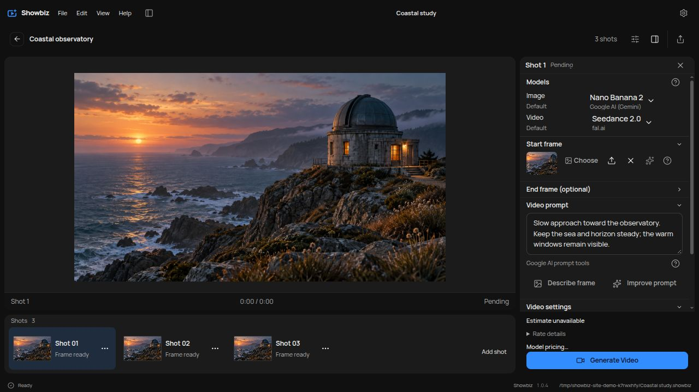
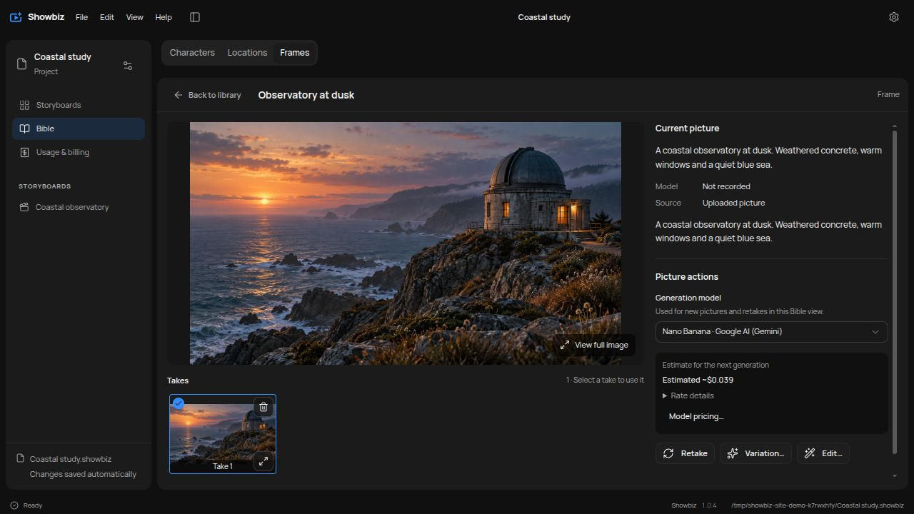

<p align="center">
  
  <h1 align="center">Showbiz</h1>
  <p align="center">
    AI-powered video storyboard desktop app.<br/>
    Build a project bible, generate storyboard images and shots, and take the media into your editor.
  </p>
  <p align="center">
    <a href="https://github.com/alexanderwanyoike/showbiz/actions/workflows/ci.yml"></a>
    <a href="https://github.com/alexanderwanyoike/showbiz/releases"></a>
    <a href="LICENSE"></a>
  </p>
</p>

<p align="center">
  
  <br/>
  <em>1.0.4 preview: storyboard shots with per-shot model controls. Demo artwork is imported, with no generation charges recorded.</em>
</p>

[Website](https://alexanderwanyoike.github.io/showbiz/) · [Release notes](https://github.com/alexanderwanyoike/showbiz/releases)

## Download

Grab the latest release for your platform from [**Releases**](https://github.com/alexanderwanyoike/showbiz/releases):

| Platform | Formats |
|----------|---------|
| Linux | `.AppImage`, `.deb` |
| macOS | `.dmg` |
| Windows | `.exe` (installer) |

On macOS and Windows, download and install new versions manually from Releases.
In-app updates are available for Linux x64 AppImage installations; Linux `.deb`
updates also use manual downloads.

## Features

- **Project files**: create or open one self-contained `.showbiz` document containing the project, storyboards and media
- **Project bible**: reusable characters, locations and frames, with dedicated detail workspaces and picture takes
- **Shot-based workflow**: each shot has a start frame, an optional end frame, and a prompt; the video model animates between the frames
- **Image generation & editing**: Nano Banana family, GPT Image 2, Flux; inpainting and prompt-based edits
- **Image & video version trees**: every generation/edit creates a version; switch non-destructively
- **Video generation**: Veo 3.1, Seedance 2, Kling 3, LTX-2.3, Wan 2.1, MiniMax H3 with start/end-frame support where the model has it
- **Storyboard handoff**: export shot images, end frames and videos as ZIP or a Forgecut-compatible `.sbz` package; Forgecut imports the media without placing it on a timeline
- **Usage and billing**: preflight estimates, recorded outcomes and actual charges where provider APIs support them; unknown charges remain labelled
- **OpenRouter and local inference**: configured cloud models and compatible local image/video endpoints
- **Dark/light theme**: system-aware with manual toggle
- **Config-driven models**: add new models by dropping a JSON file, no code changes needed

<p align="center">
  
</p>

## Supported Models

### Image Generation

| Model | Provider |
|-------|----------|
| Nano Banana / Nano Banana 2 / 2 Lite / Pro | Google (Gemini) |
| GPT Image 2 | OpenAI (via fal.ai) |
| Flux Dev / Flux Kontext | Black Forest Labs (via fal.ai) |

### Video Generation

| Model | Provider | End frames |
|-------|----------|------------|
| Veo 3.1 | Google (via fal.ai) | Optional |
| Seedance 2.0 / 2.0 Fast | ByteDance (via fal.ai) | Optional |
| Kling 3 | Kuaishou (via fal.ai) | No |
| LTX-2.3 | Lightricks (via fal.ai) | No |
| MiniMax H3 | MiniMax (via fal.ai) | Optional |
| Wan 2.1 FLF | Alibaba (via fal.ai) | Required |

## API Keys

Configure provider keys or a compatible local endpoint in **Settings**. Cloud generation needs the provider's API key; local authentication depends on your server.

| Key | Models |
|-----|--------|
| **Gemini** | Nano Banana family |
| **fal.ai** | GPT Image 2, Flux, Veo 3.1, Seedance, Kling, LTX, Wan, MiniMax |
| **OpenRouter** | Configured image models and Veo video models |
| **Local** | Compatible local image/video endpoints; configure URLs and capabilities in Settings |

Keys currently use plain-text device SQLite settings and are excluded from project packages and MCP. OS keyring encryption is not implemented. Provider requests use the native HTTP proxy.

## Tech Stack

| Layer | Technology |
|-------|-----------|
| Desktop framework | [Electron](https://www.electronjs.org/) |
| Frontend | React 19, Vite, React Router v7 |
| Styling | Tailwind CSS v4, shadcn/ui, Radix |
| Backend | Electron main process: SQLite (`node:sqlite`), file I/O |
| Video playback | HTML5 `<video>` (Chromium) |
| Storyboard packages | Streaming ZIP (`yazl`) |
| Testing | Vitest |

## Architecture

Electron main owns project SQLite packages, media files, ZIP/SBZ export and the native HTTP proxy. The renderer owns UI state and provider transport orchestration. Model JSON is discovered at build time and validated against the explicit installed catalog in the main process. See the [model configuration guide](src/lib/models/providers/README.md) before adding a transport or capability.

See [**docs/architecture.md**](docs/architecture.md) for full documentation including system diagrams, generation flow, model registry internals, version trees, and database schema.

## Prerequisites

- [Node.js](https://nodejs.org/) (v22+)
- [Yarn](https://yarnpkg.com/)

## Development

```bash
yarn install
yarn dev              # Launch Electron dev mode (Vite + Electron shell)
```

Other commands:
```bash
yarn build            # Production Electron build (installers in dist-package/)
yarn dev:frontend     # Frontend-only dev server
yarn build:frontend   # Frontend-only build
yarn test             # Run tests
yarn test:watch       # Run tests in watch mode
```

## Platform Notes

- **Data directory**: device settings, legacy-library data and disposable media caches use the app data directory (`~/.local/share/com.showbiz.app/` on Linux). Current projects live in the `.showbiz` files you choose.
- **macOS**: unsigned builds need `xattr -cr /Applications/Showbiz.app` after install to clear Gatekeeper's "damaged" error.

## Contributing

1. Fork the repository
2. Create a feature branch off `dev`
3. Open a PR targeting `dev`

See the [PR template](.github/pull_request_template.md) and [issue templates](.github/ISSUE_TEMPLATE/) for guidance.

## License

[MIT](LICENSE)

## Work with agents

Showbiz includes an MCP adapter for the running application. Agents can work with project bibles, draft and reorder storyboard shots, inspect and select takes, and request media package exports. Changes appear in the same workspace and respect unsaved UI work. See the [MCP guide](docs/mcp.md) for setup, supported tools and limits.
## Project files

Create or open a `.showbiz` document, work in its bible and storyboards, then close it or use Save As for an independent copy. The file includes the project data and all media, so it can be moved or backed up on its own. Existing library projects can be converted without changing the original library. See [project documents](docs/project-documents.md).
