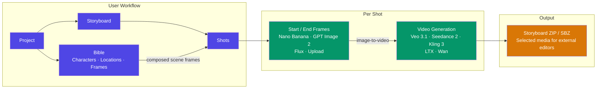
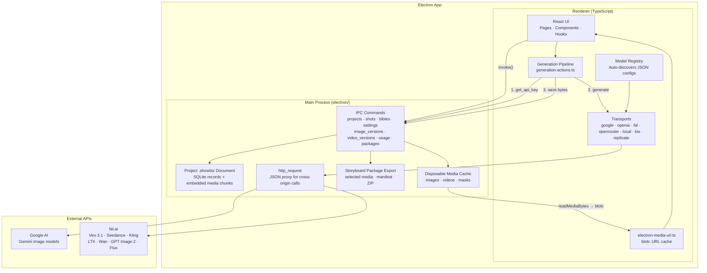
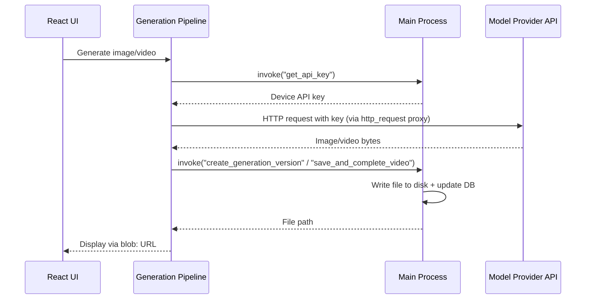
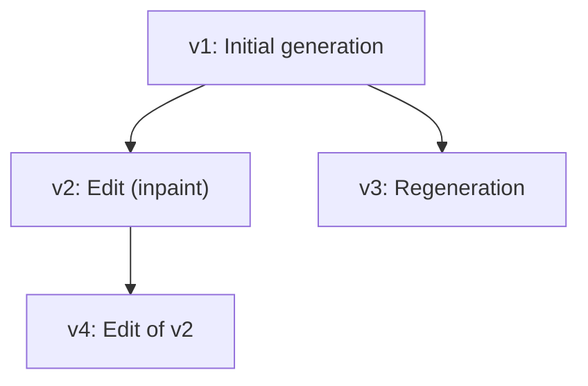

# Architecture

Showbiz is an [Electron](https://www.electronjs.org/) desktop app. The main process owns all persistent state: project documents, device settings, extracted media, usage accounting and storyboard package export. The TypeScript renderer owns the UI and makes API calls to external model providers. They communicate over a small IPC bridge (`window.showbiz`).

## High-Level Overview

## System Architecture

### Why the split?

API calls live in the renderer because:
- Model providers have complex, varied APIs (queueing, polling) that are easiest to iterate on in the frontend
- The frontend already has the generation UI state and can show real-time progress
- API keys are fetched from the main process on demand and discarded after use

Persistence lives in the main process because:
- `node:sqlite` gives synchronous, dependency-free SQLite
- File I/O stays out of the sandboxed renderer
- Package exports stream selected media from the open document's extracted cache; the self-contained document remains the durable source

Cross-origin API calls go through the main-process `http_request` command (the renderer's fetch is CORS-bound). It sends a single JSON string body, so providers must expose JSON endpoints (not multipart).

## Media Serving

Media files are served **blob-over-IPC**: the renderer asks the preload bridge for a file's bytes (`readMediaBytes`), wraps them in a `Blob`, and caches the resulting `blob:` URL per absolute path (`src/lib/electron-media-url.ts`). Saves that overwrite a file in place invalidate the cached URL.

A custom streamed protocol is deliberately avoided: Electron's `protocol.handle` mishandles Chromium's abort-and-resume media fetch pattern.

## Generation Flow

fal.ai models submit to a queue and poll for the result. Polling survives transient failures (network errors, 5xx, 429) for up to 5 consecutive attempts; the error message always names the fal request id so a completed job can be recovered from `https://queue.fal.run/{endpoint}/requests/{id}`.

## Config-Driven Model System

Each model is a JSON config file in `src/lib/models/providers/`. At build time, Vite's `import.meta.glob` auto-discovers all configs. The registry validates them against a schema and wires each one to the appropriate transport. Adding a model that uses an existing API provider requires zero TypeScript: just a JSON file.

Video configs can declare per-mode inputs: `inputs.endImage: "required"` makes validation reject start-only shots pre-submit (Wan FLF), and an `endFrameEndpoint` block routes start-only vs start+end requests to different provider endpoints with their own parameter names (Veo 3.1).

### Transports

Transports handle the API specifics for each provider. Most models reuse an existing transport : you only need a new one when integrating a completely new API.

| Transport | API | Example models |
|-----------|-----|----------------|
| `google-image` | Gemini `generateContent` | Nano Banana |
| `google-interactions-image` | Gemini Interactions API | Nano Banana 2 / Pro |
| `openai-image` | OpenAI Responses API | GPT Image 2 (direct) |
| `fal-image` | fal.ai queue | GPT Image 2, Flux |
| `fal-video` | fal.ai queue | Veo 3.1, Seedance 2, Kling 3, LTX-2.3, Wan |
| `openrouter-image`, `openrouter-video` | OpenRouter | discovered image/video models |
| `local-image`, `local-video` | configured OpenAI-compatible local server | local image/video generation |
| `kie-*`, `replicate-*` | kie.ai, Replicate | disabled alternates |
| `google-video`, `ltx` | Google AI, LTX | provider-specific video transports |

### Adding a New Model

1. Create a JSON config in `src/lib/models/providers/video/` or `image/`
2. Set the `transport`, `apiKeyProvider`, model IDs, capabilities, and defaults
3. Run `yarn test` with schema validation catches mistakes automatically

To add a completely new API provider, implement a transport in `src/lib/models/transports/`.

## Version Trees

Both images and videos use a version tree system. Every generation or edit creates a new version linked to its parent. Users can switch between versions non-destructively at any time.

Image versions and video versions are tracked independently per shot, stored in the `image_versions` and `video_versions` tables with self-referential `parent_version_id` foreign keys. Package exports use the selected image and video for each shot.

## Storyboard handoff

The main process streams selected shot media into ZIP or SBZ packages. Both use a standard ZIP container with `storyboard.json` and relative media paths. There are no timeline placements, edits or encoded movie outputs. See [the package contract](storyboard-packages.md).

## Database

The selected `.showbiz` file is a self-contained SQLite application document containing one project's records, generation usage and embedded media. `node:sqlite` opens it in the main process. Ordered migrations in `electron/migrations/` are tracked by `PRAGMA user_version`; shipped migrations are append-only. The document has the Showbiz `application_id`. See [project documents](project-documents.md) for Save As, read-only inspection, transactional replacement and crash recovery.

| Table | Purpose |
|-------|---------|
| `projects` | The open project's identity and name |
| `storyboards` | Project storyboards and default image/video models |
| `shots` | Prompts, model overrides, selected frame/video paths, settings and ordering |
| `image_versions` / `video_versions` | Version trees per shot with self-referential `parent_version_id` |
| `timeline_tracks` / `timeline_clips` | Legacy records retained for compatibility; no editor commands |
| `bibles` | Per-project asset bible |
| `bible_assets` | Characters, locations and reference frames |
| `bible_asset_variants` | Image takes and their primary selection |
| `generation_usage` | Request status, frozen estimated price basis, provider request identity and reported charges |
| `document_files` / `document_file_chunks` | Referenced media metadata and bounded 8 MiB content chunks |
| `settings` | Shared schema; application credentials are excluded from project documents |

Project media is extracted into `{appDataDir}/project-cache/open-*/media/` for playback and export. Ownership metadata sits outside that media subtree. The cache is recreated from the document when opened and removed on close. Edits synchronize record-referenced media with embedded chunks in a SQLite savepoint; unchanged files retain their fingerprints. Changed large media still blocks the main thread during synchronous embedding. The cache is disposable and is not part of project sharing or backup.

The legacy `{appDataDir}/data/showbiz.db` remains the device-settings store and the conversion source for older library projects, with their original media at `{appDataDir}/media/`. It is not the active document's database. Conversion copies one project into a separate `.showbiz` file and excludes device settings. Recent file shortcuts live in `{appDataDir}/recent-projects.json`.

## Pricing and usage

The renderer asks the native pricing/accounting commands for a quote before generation and records the price basis with the request. Provider-supported pricing APIs supply live values; cached, published and custom rates are labelled according to their source and retrieval time. Provider-reported charges remain separate from estimates. Successful output stays available if later accounting writes or receipt reconciliation fail. The Usage view reads the local ledger before background provider reconciliation. See [generation usage](generation-usage.md) for provider capabilities and estimation limits.

## Agent access

The stdio MCP adapter discovers local application instances and attaches to a selected instance. The main process owns document state and command validation, so agents and the renderer share persistence, work guards and mutation revisions. Credentials stay outside the project. Discovery security and native platform limits are documented in [MCP](mcp.md).
