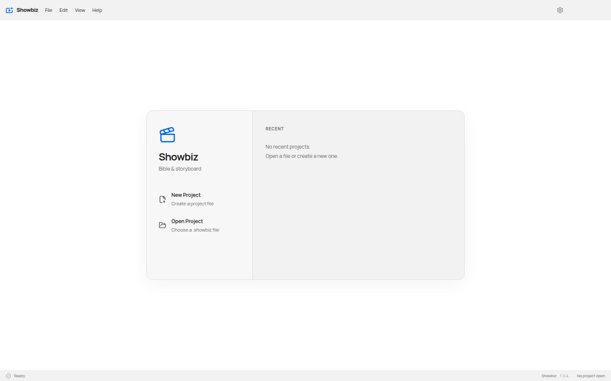

# Linux desktop integration

A packaged AppImage registers `showbiz.desktop` on first launch in `$XDG_DATA_HOME/applications`, falling back to `~/.local/share/applications`. The entry matches the application's existing `desktopName` and `showbiz` window class. It launches the original `APPIMAGE` path with project-file arguments and references a persistent icon copied into the user's icon directory. Temporary AppImage mount paths are not saved.

Showbiz refreshes entries carrying `X-Showbiz-AppImage-Integration=true` when the AppImage moves. Existing custom entries are preserved. New entries are published without overwriting a concurrent writer; updates and icon replacements use temporary files and atomic replacement. Integration errors return a typed failure, are reported on stderr and do not prevent the application from opening.

Development runs, non-Linux platforms and packaged launches without `APPIMAGE` do not create user launchers. Debian packages retain package-manager installation of their desktop entry and icons. The icon generator supplies 16, 24, 32, 48, 64, 128, 256 and 512px PNGs to Linux packaging. A lone 1024px directory is not listed in the standard hicolor theme and failed actual GTK menu-icon lookup.

## Patterns and licences

- [Auto Digger's AppImage integration](https://github.com/alexanderwanyoike/auto-digger/blob/986f1a7c79e546d48cc63f117e15a8ac4999dcbc/src/main/desktop/appImage.ts) provides the XDG launcher and persistent-icon pattern, including the `env --` executable wrapper needed for GLib's percent handling. Its MIT notice is retained in [AutoDigger-MIT-LICENSE.txt](../public/AutoDigger-MIT-LICENSE.txt).
- [Muzo's AppImage menu integration](https://github.com/alexanderwanyoike/muzo/blob/ccb8f9999372c80e68e218be1b58d7028d071ef0/apps/desktop/electron/install-appimage-menu.ts) informs managed-entry ownership and atomic publication. This is a pattern reference; no Muzo source was copied.
- The [freedesktop desktop-entry specification](https://specifications.freedesktop.org/desktop-entry-spec/latest/) defines executable quoting and field codes. The [icon-theme specification](https://specifications.freedesktop.org/icon-theme/latest/) defines hicolor fallback and theme directory lookup.

## Verification

Regression tests exercise filesystem registration, managed updates, custom-entry preservation, path validation, failures and real GIO execution with quoted filenames and project paths. The icon-generation test checks that Linux packaging consumes the complete size set.

Packaging verification extracts the generated Debian package and asks GTK's hicolor theme to resolve `showbiz` at menu sizes. AppImage verification runs the actual package under an isolated Xvfb display and device profile, checks its first-launch desktop entry and persistent icon, and reads the native X11 `_NET_WM_ICON` property. This does not visually confirm the user's Cinnamon menu or dock.

The published 1.0.4 AppImage reproduced the missing entry; the rebuilt package registered it in a fresh profile. Its native icon decoded at 1024px and X11 reported matching `showbiz` window classes and a populated `_NET_WM_ICON`. A second run with an obstructed applications directory reported the integration failure while still opening the project launcher.

