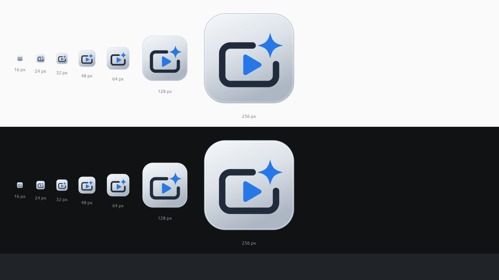
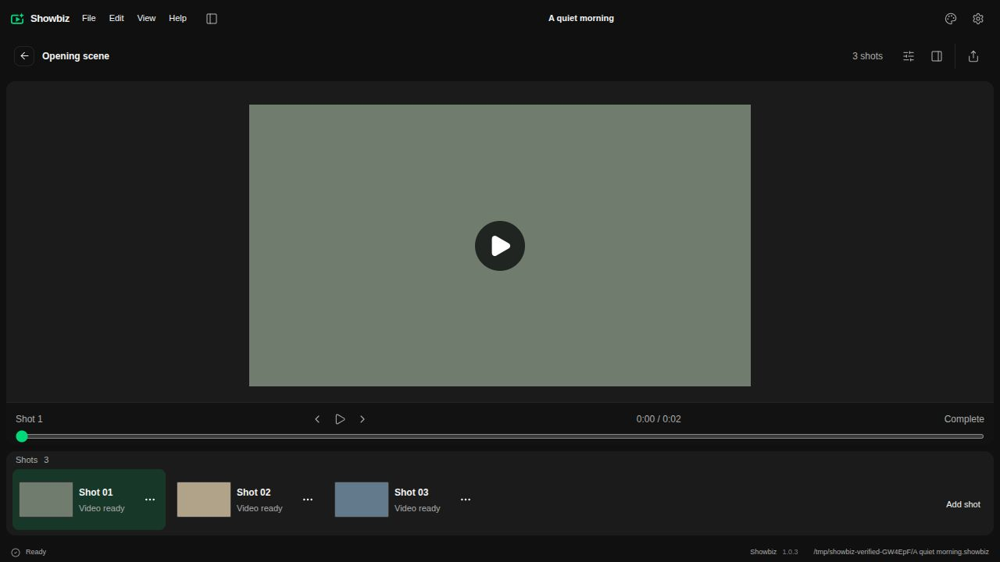
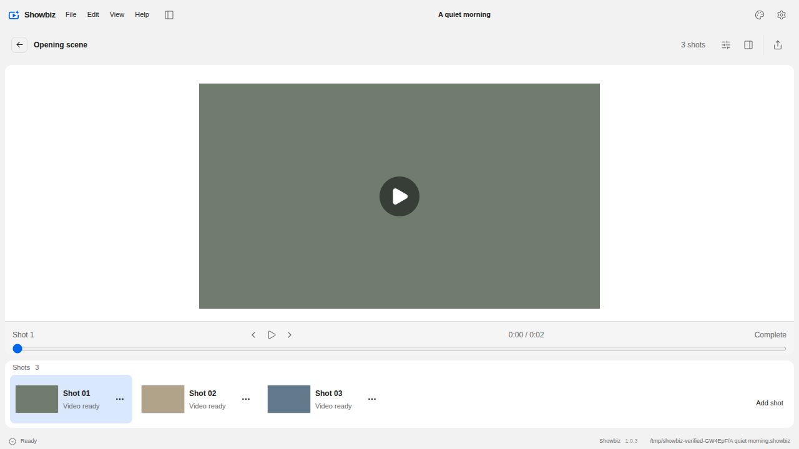

# Showbiz app icon

The icon combines an open video frame, a play triangle and one generative glint. The dark frame and blue symbols sit on an aluminium tile. The titlebar uses the same geometry in the selected theme accent.

## References and source

- [Auto Digger's icon](https://github.com/alexanderwanyoike/auto-digger/blob/20ce4f5126a333d81e885cd3aa4edb1edf7e8e1d/resources/icons/icon.svg) informs the aluminium tile. Its [generation script](https://github.com/alexanderwanyoike/auto-digger/blob/20ce4f5126a333d81e885cd3aa4edb1edf7e8e1d/scripts/generate-icons.ts) establishes the SVG, sharp and png2icons pipeline used here. Both are MIT licensed; the retained notice is [AutoDigger-MIT-LICENSE.txt](../../public/AutoDigger-MIT-LICENSE.txt).
- [Forgecut's current icon](https://github.com/alexanderwanyoike/forgecut/blob/1e01ee41cf3492abdf0d36dea9643c784ccdd00b/apps/forgecut_gui/ui/electron/assets/icon.svg) provides the current sibling reference. The older local checkout contained the superseded illustrated clapperboard.
- The installed Muzo 0.0.4 icon informs the simple silhouette and restrained use of saturated blue. Its artwork was inspected, not copied.
- The Showbiz video and glint geometry is original. [public/icon.svg](../../public/icon.svg) is the editable master for the app assets and titlebar mark.

The titlebar embeds the trusted source definitions at build time. It avoids external SVG requests because [`use` references require the same origin](https://developer.mozilla.org/en-US/docs/Web/SVG/Guides/Linking), while [file origins vary between browsers](https://developer.mozilla.org/en-US/docs/Web/Security/Defenses/Same-origin_policy). Electron security settings are unchanged.

Run `yarn icons:generate` after changing the source, then commit the generated PNG, ICO, ICNS and website icons. `yarn icons:check` verifies that the committed assets match the master without changing them. The byte-exact check runs in Linux CI only.

## Verification

The rendered SVG was inspected at 16, 24, 32, 48, 64, 128 and 256 pixels on light and dark backgrounds.

The actual storyboard workspace was opened with the production build and an isolated project. The titlebar mark was inspected in dark mode with Emerald and in light mode with Showbiz blue. Only local fixture media was used.

Automated checks passed: 1,224 Vitest tests, five icon generation regressions, 39 distribution tests and strict TypeScript checking. Packaged `dist/icon.png` and `dist/icon.svg` were compared with the committed source assets and match byte for byte. Windows ICO and macOS ICNS containers were generated and checked, but those desktop launchers were not manually exercised on this Linux host.

Generate icon assets on Linux with `yarn icons:generate`. macOS and Windows tests and packaging use the committed assets without requiring byte-identical platform converter output.
