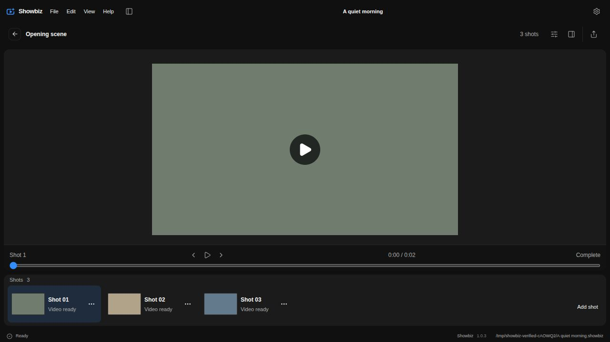
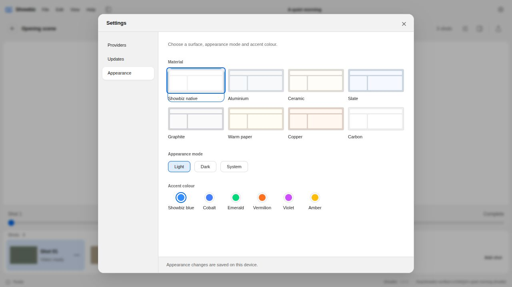

# Titlebar Settings

The titlebar has one Settings command. Appearance remains a tab inside Settings, with the existing View menu shortcut still available.

The titlebar reserves the native window controls using [Electron's documented CSS environment geometry](https://www.electronjs.org/docs/latest/tutorial/custom-title-bar), followed by an 8px gap. The 138px fallback applies only when that geometry is unavailable. Removing the transparent border keeps the 48px titlebar and its centered controls on the same vertical bounds.

Manual verification used the production frontend with an isolated local project. Settings opened, Appearance was selected, changing Light to Dark updated the workspace, and Escape returned focus to the Settings button. Native window-control geometry cannot be observed in the browser preview; final OS caption spacing was not manually exercised.

